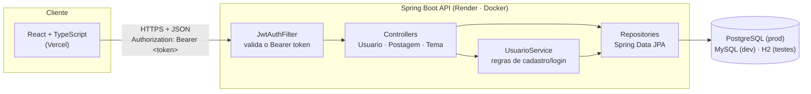
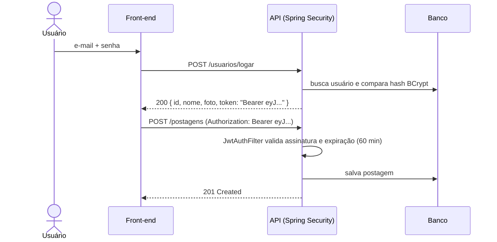
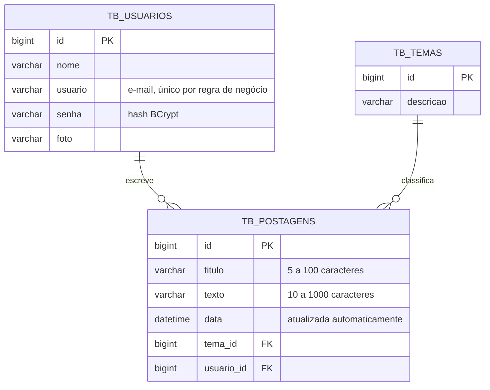

<div align="center">

# 📝 Blog Pessoal — API REST

API de um blog com autenticação JWT: usuários se cadastram, fazem login e publicam postagens organizadas por temas.


[](https://github.com/Day-Barbosa/blog-pessoal-api/actions/workflows/ci.yml)


**[📖 Swagger (deploy)](https://blog-pessoal-paet.onrender.com)** · **[🌐 Front-end ao vivo](https://blog-pessoal-web-gilt.vercel.app)** · **[💻 Repositório do front](https://github.com/Day-Barbosa/blog-pessoal-web)**

<sub>Hospedado no plano gratuito do Render: a primeira requisição depois de um tempo parado pode levar ~50 s para "acordar" o servidor.</sub>

</div>

---

## 💡 Sobre o projeto

Um blog precisa de duas coisas: **publicar conteúdo organizado** e **garantir que só o autor autenticado mexa nele**. Esta API resolve as duas com um CRUD completo de postagens e temas, protegido por autenticação **stateless com JWT**, senhas criptografadas com **BCrypt** e validação de dados em todas as entradas. Está em produção no Render (PostgreSQL) e é consumida pelo [front-end em React](https://github.com/Day-Barbosa/blog-pessoal-web).

<!-- 📸 MÍDIA: grave um GIF do Swagger (login → copiar token → "Authorize" → criar postagem) e salve em docs/swagger-demo.gif. Depois troque este comentário por:
<p align="center"></p>
-->

## 🏗️ Arquitetura e decisões técnicas



| Decisão | Por quê |
|---|---|
| **Spring Boot 3.5 + Java 21** | Versões LTS, ecossistema maduro e configuração mínima para expor uma API REST. |
| **JWT stateless** (`SessionCreationPolicy.STATELESS`) | O front em outro domínio (Vercel) só precisa guardar o token; o servidor não mantém sessão e escala sem estado compartilhado. |
| **BCrypt** para senhas | Hash com *salt* e custo configurável; a senha em texto puro nunca é salva. |
| **Senha `WRITE_ONLY`** no JSON | A API aceita a senha no cadastro, mas nunca a devolve nas respostas (coberto por teste). |
| **Bean Validation + `@RestControllerAdvice`** | Erros de validação voltam como `400` com um JSON padronizado por campo, fácil de exibir no front. |
| **Perfis `dev` / `test` / `prod`** | MySQL local, H2 em memória nos testes e PostgreSQL em produção, sem mudar código. |
| **Segredos em variáveis de ambiente** | `JWT_SECRET` e credenciais do banco vêm do ambiente; o repositório só tem valores de desenvolvimento. |
| **Dockerfile multi-stage** | Build com Maven em uma imagem e execução em outra; é o que o Render usa no deploy. |

### Fluxo de autenticação



### Modelo de dados



## ✨ Funcionalidades

- Cadastro de usuário com e-mail único e senha criptografada (BCrypt)
- Login que devolve um **token JWT** válido por 60 minutos
- CRUD de **temas**, com busca por descrição
- CRUD de **postagens**, com busca por título e vínculo obrigatório a um tema existente
- Rotas protegidas: sem token válido a API responde `401`
- Validação de entrada com mensagens em português e resposta de erro padronizada
- Documentação interativa com **Swagger / OpenAPI** na raiz da aplicação

## 🔌 Endpoints

| Método | Rota | Acesso | Descrição |
|---|---|---|---|
| `POST` | `/usuarios/cadastrar` | Público | Cria usuário |
| `POST` | `/usuarios/logar` | Público | Autentica e retorna o token |
| `GET` | `/usuarios/all` | 🔒 Token | Lista usuários |
| `GET` | `/usuarios/{id}` | 🔒 Token | Busca usuário |
| `PUT` | `/usuarios/atualizar` | 🔒 Token | Atualiza usuário |
| `GET` | `/temas` · `/temas/{id}` · `/temas/descricao/{descricao}` | 🔒 Token | Lista / busca temas |
| `POST` · `PUT` | `/temas` | 🔒 Token | Cria / atualiza tema |
| `DELETE` | `/temas/{id}` | 🔒 Token | Remove tema |
| `GET` | `/postagens` · `/postagens/{id}` · `/postagens/titulo/{titulo}` | 🔒 Token | Lista / busca postagens |
| `POST` · `PUT` | `/postagens` | 🔒 Token | Cria / atualiza postagem |
| `DELETE` | `/postagens/{id}` | 🔒 Token | Remove postagem |

<details>
<summary>Exemplo de erro de validação</summary>

```json
{
  "status": 400,
  "erro": "Dados inválidos",
  "campos": {
    "titulo": "O atributo título deve conter no mínimo 5 e no máximo 100 caracteres"
  },
  "timestamp": "2026-11-20T19:30:00"
}
```
</details>

## 🧪 Testes

Testes de integração com **JUnit 5 + `TestRestTemplate`**, sobre o servidor real em porta aleatória e banco **H2 em memória**. Eles rodam a cada push pelo **GitHub Actions**.

| Suíte | O que garante |
|---|---|
| `UsuarioControllerTest` | cadastro, bloqueio de e-mail duplicado, atualização, listagem e **senha nunca exposta** |
| `TemaControllerTest` | criação, atualização (`200`), `400` sem id, `404` para inexistente, `401` sem token |
| `PostagemControllerTest` | `400` com tema inexistente, título inválido e atualização sem id |

```bash
./mvnw test
```

## 🚀 Como rodar localmente

**Pré-requisitos:** Java 21. Docker é opcional.

### Opção 1: sem instalar banco (H2 em memória)

```bash
git clone https://github.com/Day-Barbosa/blog-pessoal-api.git
cd blog-pessoal-api
./mvnw spring-boot:run          # no Windows: mvnw.cmd spring-boot:run
```

Abra **http://localhost:8080** para ver o Swagger. Os dados somem quando a aplicação para.

### Opção 2: com MySQL via Docker Compose

```bash
cp .env.example .env            # ajuste a senha se quiser
docker compose up --build
```

Sobe o MySQL 8.4 e a API (perfil `dev`) em **http://localhost:8080**.

### Variáveis de ambiente

| Variável | Perfil | Descrição |
|---|---|---|
| `DB_USERNAME` / `DB_PASSWORD` | `dev` | Credenciais do MySQL local (padrão `root` / `root`) |
| `SPRING_PROFILES_ACTIVE` | — | `dev` ou `prod` (sem valor: H2 em memória) |
| `SPRING_DATASOURCE_URL` / `_USERNAME` / `_PASSWORD` | `prod` | Conexão com o PostgreSQL |
| `JWT_SECRET` | todos | Chave Base64 de 256+ bits (`openssl rand -base64 32`). **Obrigatória em produção** |

### Testando o fluxo

1. `POST /usuarios/cadastrar` com `{ "nome": "Ana", "usuario": "ana@email.com", "senha": "12345678", "foto": "" }`
2. `POST /usuarios/logar` com `{ "usuario": "ana@email.com", "senha": "12345678" }` e copie o `token`
3. No Swagger, clique em **Authorize** e cole o token (sem a palavra `Bearer`)
4. Crie um tema em `POST /temas` e depois uma postagem em `POST /postagens` usando o `id` do tema

## 📁 Estrutura

```text
src/main/java/com/generation/blogpessoal
├── configuration/   # Swagger / OpenAPI
├── controller/      # Endpoints REST
├── exception/       # Tratamento global de erros de validação
├── model/           # Entidades JPA + validações
├── repository/      # Spring Data JPA
├── security/        # JWT, filtro, UserDetails e SecurityConfig
└── service/         # Regras de cadastro e autenticação
```

## 🗺️ Próximos passos

- [ ] DTOs de entrada/saída para desacoplar as entidades da API
- [ ] Paginação nas listagens (`Pageable`)
- [ ] Restringir edição e exclusão de postagens ao próprio autor
- [ ] Relatório de cobertura de testes (JaCoCo)

## 👩‍💻 Autora

**Dayana Barbosa** · [LinkedIn](https://www.linkedin.com/in/dayanabarbosa-devjava/) · [GitHub](https://github.com/Day-Barbosa)

Projeto desenvolvido na formação Java Fullstack da Generation Brasil e evoluído depois com testes, CI e boas práticas de segurança.

---

<sub>Distribuído sob a licença MIT. Veja [`LICENSE`](LICENSE).</sub>
